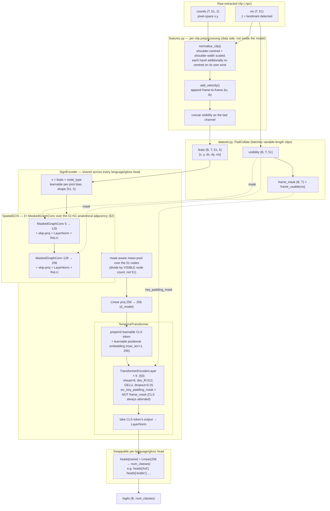
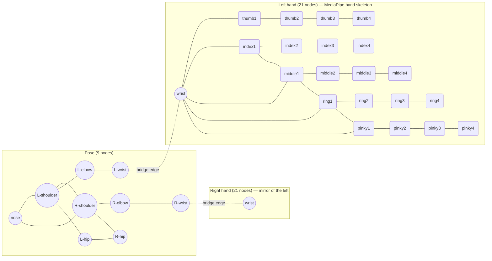
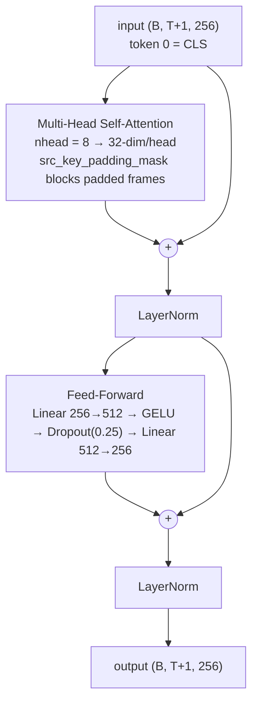

# Model Architecture

Diagram of the model actually implemented in [scripts/model_claude.py](scripts/model_claude.py)
(`MultiHeadSignModel`), as trained by [scripts/training/train.ipynb](scripts/training/train.ipynb).
For the higher-level project rationale (why this pipeline, dataset strategy, training
stages) see [ksl_sign_model_design.md](ksl_sign_model_design.md); this document is the
literal architecture, grounded in the current code.

**Tensor contract** (`SignEncoder.forward` / `MultiHeadSignModel.forward`):

| Tensor | Shape | Meaning |
| --- | --- | --- |
| `feats` | `(B, T, V=51, C_in=5)` | per-node `[x, y, dx, dy, vis]` |
| `visibility` | `(B, T, 51)` | 1 = real landmark, 0 = absent → drives mask-aware GCN aggregation |
| `frame_mask` | `(B, T)` | 1 = usable frame, 0 = padding/total detection failure → drives Transformer attention masking |

51 nodes = 9 upper-body pose + 21 left-hand + 21 right-hand (legs/feet dropped at
extraction — no signing information).

---

## 1. End-to-end pipeline

**Why a shared encoder + swappable heads:** the GCN+Transformer backbone (`SignEncoder`)
never changes shape between languages — only which `nn.Linear` head sits on top does. That's
what lets a Stage-1 checkpoint pretrained on e.g. Arabic/RSL warm-start KSL fine-tuning
(`model.load_state_dict(ckpt, strict=False)` copies every `encoder.*` weight and silently
drops the mismatched `heads.*` keys — see the co-training / fine-tuning discussion elsewhere
in this repo's history) and what lets `multilingual_pretrain` train several heads on one
encoder at once, round-robin.

---

## 2. Anatomical adjacency (the GCN's graph)

`build_adjacency()` returns a fixed, symmetric 51×51 binary matrix — **not learned** — built
from real skeletal bones, not a fully-connected or attention-derived graph. A learnable
`edge_importance` weight (one scalar per matrix entry) can up/down-weight an existing edge
but can never invent a non-anatomical one (it multiplies the base graph, never adds to it).

(Right hand collapsed to its wrist node here for readability — it's an exact mirror of the
left hand's 21-node/25-edge finger topology: thumb/index/middle/ring/pinky chains + 3
knuckle-bridge edges + palm-base edges.) The two **bridge edges** (pose wrist ↔ that hand's
own wrist node) are what let a hand-shape signal reach the arm/body graph at all — without
them the hands and pose would be two disconnected components.

**Mask-aware aggregation** (`MaskedGraphConv`, not shown as its own diagram — it's a small
edit to the standard `A_norm @ (XW)` GCN update):

1. `A = base_adjacency * edge_importance` (learnable weights, anatomical structure fixed)
2. add self-loops, broadcast to `(B, T, V, V)`
3. **zero out column j** wherever node `j` is not visible in that frame — an absent joint
   contributes exactly 0 to every neighbour instead of leaking a fake `(0,0)`
4. row-normalise by the **visible** degree only (not the fixed graph degree)
5. aggregate: `einsum("btij,btjc->btic", A, XW)`

A one-handed sign therefore never gets a phantom "hand at the origin" signal — the other
hand's nodes simply drop out of every neighbour's average for that frame.

---

## 3. One `TransformerEncoderLayer` (× 6, `nn.TransformerEncoder` — PyTorch stock layer)

`model_claude.py` constructs `nn.TransformerEncoderLayer` without passing `norm_first`,
so it uses PyTorch's default — **Post-LN** (normalize *after* each residual add, not
before):

Padded frames are masked out of attention entirely (`src_key_padding_mask`), not just
zero-valued — they contribute to no query's weighted sum. The CLS token's padding-mask entry
is always `False` (always attended to), and after all 6 layers, `TemporalTransformer` reads
**only the CLS token's final vector** (`x[:, 0]`) as the whole clip's representation, then
applies one more `LayerNorm` before it reaches the classifier head.

---

## 4. Configured vs. default hyperparameters

`SignEncoder`/`SpatialGCN`/`TemporalTransformer` all ship small defaults in
`model_claude.py` itself; `train.ipynb` §2/§7 overrides every one of them for actual
training runs. The diagrams above use the **train.ipynb** column.

| Hyperparameter | `model_claude.py` default | `train.ipynb` (current) |
| --- | --- | --- |
| `in_ch` (`C_in`) | *(required, no default)* | 5 — `[x, y, dx, dy, vis]` |
| `gcn_hidden` | `(64, 128)` | `(128, 256)` |
| `d_model` | 128 | 256 |
| `nhead` | 4 | 8 |
| `num_layers` (Transformer) | 4 | 6 |
| `dim_ff` | 256 | 512 |
| `dropout` | 0.2 | 0.25 |
| `max_len` | 128 | 128 |

At the `train.ipynb` configuration, the shared backbone (`SignEncoder`) is **~4M
parameters**; each per-language head adds only `256 × num_classes + num_classes`
(e.g. ~50K params for KSL's 194 classes) — negligible next to the shared encoder,
which is the whole point of the multi-head design.
