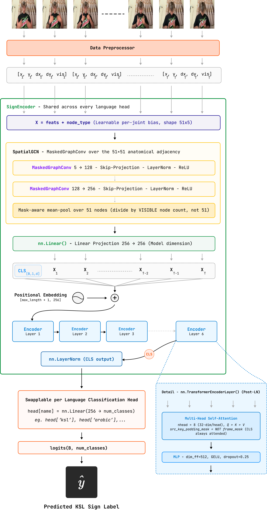

<p align="center">
  
</p>

<h1 align="center">KSL Recognition</h1>

<p align="center"><em>Attention to Sign: Multilingual Transfer Learning for Low-Resource Khmer Sign Language Recognition</em></p>

<p align="center">
  
  
  
  
  
  
</p>

Khmer Sign Language (KSL) is used daily by Cambodia's Deaf community but has almost no
digital infrastructure. This project is an isolated-sign recognition system built from
MediaPipe body/hand landmarks: a mask-aware Graph Convolutional Network (GCN) models each
frame's skeleton, a Transformer encoder models motion over time, and a two-stage
cross-lingual pretraining strategy (six source sign languages → KSL) addresses KSL's data
scarcity. Full methodology, related work, and results are written up in
[`Attention_to_Sign-Multilingual_Transfer_Learning_for_Low-Resource_Khmer_Sign_Language_Recognition.pdf`](Attention_to_Sign-Multilingual_Transfer_Learning_for_Low-Resource_Khmer_Sign_Language_Recognition.pdf) — this README
covers the code.

```
video → MediaPipe Holistic → (coords, visibility) landmarks
      → feature assembly (position + velocity + visibility)
      → mask-aware GCN (spatial) → Transformer encoder (temporal) → classifier
```

## Results

The best model — mask-aware GCN + Transformer, pretrained jointly on Arabic + Argentine +
RSL and co-trained into KSL — reaches **93.58% top-1 validation accuracy** on the 194-class
KSL target set, with **3.39M parameters**. It outperforms a family of recurrent baselines
(RNN, LSTM, BiLSTM, GRU, BiGRU) trained under the identical pipeline at every pretraining
combination tested.

| Model | Parameters | Best KSL accuracy (fully-supervised) |
|---|---|---|
| RNN | 313K | 88.28% |
| GRU | 839K | 90.62% |
| LSTM | 1.10M | 90.21% |
| BiGRU | 2.07M | 91.90% (from scratch) |
| BiLSTM | 2.73M | 90.73% |
| **GCN + Transformer (ours)** | **3.39M** | **93.58%** |

An ablation study isolates why: removing the frame-usability rule (masking any frame
missing a hand, instead of only fully-undetected frames) costs **29.31 points**; removing
node-level visibility masking costs 5.33 points; replacing the anatomical adjacency with a
fully-connected graph costs 4.54 points. Full tables (Stage-1 pretraining sweep, Stage-2
fine-tuning, few-shot K=1/3/10, ablation) are in the paper's Section 5.

[PLACE_HOLDER: short screen-recording or screenshot of the real-time web demo
(github.com/Phal-Sovandy/Khmer-Sign-Language-Translation-System) predicting a sign live —
referenced in the paper's Discussion but no image/gif of it lives in this repo]

## Model architecture

`ksl_recognition.models.sign_model.MultiHeadSignModel` — 51 landmarks per frame (9 upper-body
pose + 21 per hand; legs/feet dropped, no signing information) laid out as a **fixed
anatomical adjacency graph**, not learned or fully-connected: pose edges, each hand's own
MediaPipe skeleton, and a bridge edge from each pose wrist to that hand's wrist node. A
learnable per-edge importance weight can reweight an existing bone connection but can never
invent a new one.

**Mask-aware graph convolution** (`MaskedGraphConv`, 2 layers, 5→128→256): the adjacency is
multiplied by each frame's node-visibility vector before row-normalizing, so an absent
landmark (MediaPipe failed to detect it — occluded, out of frame, or resting during a
one-handed sign) contributes exactly zero to its neighbors, rather than leaking a fake
`(0, 0)` origin point. Pooling afterward divides by the *visible* node count, not the fixed
51.

**Temporal Transformer** (6 layers, `d_model=256`, `nhead=8`, `dim_ff=512`, `dropout=0.25`):
per-frame GCN embeddings get a prepended learnable CLS token and learned positional
encodings; a key-padding mask (from a separate, coarser frame-usability rule — a frame is
masked only if *no* landmark was detected at all, so one-handed signs are never discarded)
excludes padding from attention. The final CLS token, after a closing LayerNorm, is the
whole clip's embedding.

**Shared encoder, swappable heads**: one `SignEncoder` backbone is shared across every
pretraining language; each language gets its own `nn.Linear` classification head
(`model.heads['arabic']`, `model.heads['ksl']`, ...). A Stage-1 checkpoint warm-starts KSL
fine-tuning by loading every `encoder.*` weight and dropping the mismatched head
(`strict=False`); `train_multilingual.py` trains several heads on one shared encoder at
once, round-robin.

See [`MODEL_ARCHITECTURE.md`](MODEL_ARCHITECTURE.md) for the full tensor-by-tensor diagram
and layer-by-layer detail (mermaid flowcharts of the pipeline, the 51-node adjacency graph,
and one Transformer encoder layer), and the diagram below for the same pipeline drawn out
end-to-end:



## Dataset

The KSL target set combines a 100-class corpus provided by the National Institute for
Special Education (NISE), Phnom Penh — credit to NISE for that portion — and a 94-class
corpus self-collected from 6 signers on the
project team — **194 classes, 5,052 samples** total, a signer-independent-by-construction,
~10x expansion over the 20-class pilot corpora used in prior KSL work (neither NISE nor the
self-collected portion is publicly released). Six public corpora serve as Stage-1
cross-lingual pretraining sources:

| Language | Dataset | Source |
|---|---|---|
| ASL | WLASL | [github.com/dxli94/WLASL](https://github.com/dxli94/WLASL) |
| RSL | Slovo | [github.com/hukenovs/slovo](https://github.com/hukenovs/slovo) |
| Arabic SL | ArSL (words) | [Kaggle](https://www.kaggle.com/datasets/eslamezzat/arabic-sign-language-arsl-for-words-videos) |
| Argentine SL | LSA64 | [facundoq.github.io/datasets/lsa64](https://facundoq.github.io/datasets/lsa64/) |
| Indian SL | INCLUDE | [doi.org/10.1145/3394171.3413528](https://doi.org/10.1145/3394171.3413528) |
| Indian SL (2) | Greetings dataset | [Kaggle](https://www.kaggle.com/datasets/manojkumarcs28/indian-sign-language-greetings-video-dataset) |
| Sri Lankan SL | SSL400 | [doi.org/10.1109/ICARC64760.2025.10962991](https://doi.org/10.1109/ICARC64760.2025.10962991) |


## Project layout

```
src/ksl_recognition/
├── data/          # dataset loading, feature assembly, augmentations
├── models/        # the GCN+Transformer model and RNN/LSTM/GRU baselines
├── extraction/    # per-dataset MediaPipe landmark extraction (+ a one-time pose-trim migration)
├── training/      # single-language, multilingual-pretrain, baseline training loops
├── inference/     # batch (.npz) and real-time (webcam) inference
├── export/        # dataset repackaging: opaque class IDs, Kaggle-ready trees
└── analysis/      # EDA (class/frame-length distributions) and t-SNE / UMAP embeddings

notebooks/
├── train.ipynb       # interactive Stage-1/Stage-2 training (same pipeline as the CLIs)
├── ablation.ipynb    # Table 4: 5 configs, each design element removed one at a time
└── few_shot.ipynb    # Table 5: K=1/3/10-shot fine-tuning, all 6 models, multi-trial mean±std

assets/                      # README images: logo, architecture diagram, dataset preview
data/                        # datasets (gitignored — see Data below)
checkpoints/                 # trained model weights (gitignored)
best_Pretrain_model_RNN/     # best Stage-1 checkpoint per recurrent baseline
plots/                       # generated figures, EDA output, results JSON/xlsx (gitignored)
scripts/                     # (currently empty — thin CLI wrappers can go here)
Attention_to_Sign-Multilingual_Transfer_Learning_for_Low-Resource_Khmer_Sign_Language_Recognition.pdf  # the full write-up: methodology, related work, results
MODEL_ARCHITECTURE.md               # detailed architecture diagrams, grounded in the code
```

## Setup

Requires Python ≥ 3.9.

```bash
git clone <this-repo>
cd ksl-recognition
pip install -e ".[dev]"
```

`pip install -e .` alone pulls the core runtime dependencies (torch, numpy, opencv,
mediapipe, pandas, pillow, tqdm); `[dev]` also adds the optional extras used by the
real-time demo, dataset export, and EDA scripts (`psutil`, `openpyxl`, `matplotlib`,
`scikit-learn`, `umap-learn`, `scipy`). See `pyproject.toml` for the individual extras if
you only need one.

Every command below is a Python module and expects to run from the repo root, e.g.
`python -m ksl_recognition.training.train --help`.

## Data

Datasets are not tracked in git (100+ GB of video/landmarks) and are expected on disk as:

```
data/raw_data/<dataset>/...                          # source videos
data/processed_landmarks/<dataset>/<class>/*.npz      # coords (T,51,2) + vis (T,51)
```

Landmark extraction shares one MediaPipe Holistic core (`extraction/utils.py`); each
dataset gets its own thin script under `src/ksl_recognition/extraction/` only to handle
that source's folder layout, but every one of them reads as either raw video or
pre-extracted frame sequences:

| Input type | Example script | Datasets |
|---|---|---|
| Video files (`.mp4`/`.MOV`) | `extract_landmarks.py` | KSL (core), Slovo, WLASL, Arabic, Argentine, Indian, Sri Lankan |
| Pre-extracted frame sequences (folders of `.jpg`) | `extract_new_ksl_landmarks.py` | KSL — new words, Arabic SL (2) |

```bash
python -m ksl_recognition.extraction.extract_landmarks \
    --input data/raw_data/ksl_dataset --output data/processed_landmarks/ksl --workers 8
```

`ksl_recognition.extraction.count_files` gives a quick raw-vs-extracted progress check
across every dataset. `ksl_recognition.extraction.migrate_trim_pose` is a one-time (but
re-runnable) migration for `.npz` files extracted before pose was trimmed to upper-body-only.

## Training

Two-stage recipe: pretrain a shared encoder across every available source language, then
fine-tune (or co-train) it on KSL.

```bash
# Stage 1 — joint multilingual pretrain
python -m ksl_recognition.training.train_multilingual --epochs 500 --steps-per-lang 60

# Stage 2 — fine-tune on KSL from the Stage-1 encoder
python -m ksl_recognition.training.train \
    --data data/processed_landmarks/ksl \
    --pretrained checkpoints/multilingual_pretrain.pt \
    --enc-lr 1e-4 --head-lr 1e-3
```

Recurrent baselines (RNN/LSTM/BiLSTM/GRU/BiGRU), trained under the identical pipeline for a
fair ablation against the GCN+Transformer:

```bash
python -m ksl_recognition.training.train_baselines --models lstm bilstm --epochs 100
```

`notebooks/train.ipynb` covers the same two-stage pipeline interactively, with per-stage
config blocks and resumable checkpointing.

### Ablation and few-shot studies

`notebooks/ablation.ipynb` reruns the full architecture from scratch with exactly one
design element removed per config (node-level visibility masking, the frame-usability rule,
anatomical adjacency, or normalization-aware augmentation) under the co-training protocol,
to produce Table 4. `notebooks/few_shot.ipynb` fine-tunes each of the 6 models' KSL head on
K=1/3/10 labeled examples per class, averaged over multiple random supports, to produce
Table 5. Both are resumable — results are saved to `plots/` after every run/trial, so an
interrupt only costs unfinished work.

## Inference

```bash
# One .npz clip or a directory of them
python -m ksl_recognition.inference.infer --model checkpoints/ksl_best.pt --input data/processed_landmarks/ksl/<gloss>/<clip>.npz

# Live webcam demo
python -m ksl_recognition.inference.infer_realtime --model checkpoints/ksl_best.pt
```

A separate real-time web deployment (informally tested against BiLSTM/BiGRU for inference
speed — the GCN+Transformer came out fastest overall) lives at
[Khmer-Sign-Language-Translation-System](https://github.com/Phal-Sovandy/Khmer-Sign-Language-Translation-System).

## Paper

The full writeup — related work, dataset construction, formal architecture definitions,
training protocol, and complete results (pretraining-language sweep, ablation, few-shot,
discussion of limitations) — is [`Attention_to_Sign-Multilingual_Transfer_Learning_for_Low-Resource_Khmer_Sign_Language_Recognition.pdf`](Attention_to_Sign-Multilingual_Transfer_Learning_for_Low-Resource_Khmer_Sign_Language_Recognition.pdf).

## Contributors

- [Sovandy Phal](https://github.com/Phal-Sovandy)
- [Vat Vann](https://github.com/monotai)
- [Hangcheav Chhi](https://github.com/Hangcheavchhi)
- [Meakputsoktheara Mony](https://github.com/araeht)
- [Panhaprasith Chim](https://github.com/CPS168)
- [Hengsreng Toek](https://github.com/Hengsreng2409)

Department of Computer Science, Cambodia Academy of Digital Technology (CADT), Phnom Penh.

## License

MIT — see [LICENSE](LICENSE).
